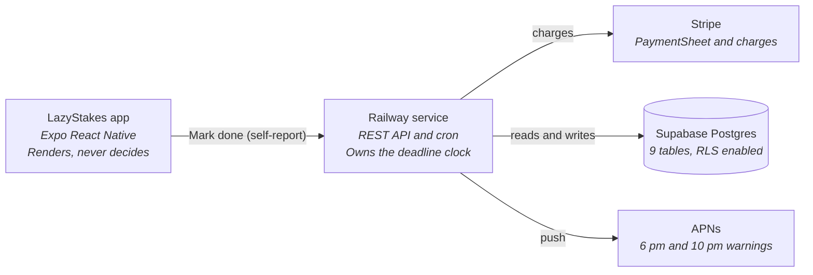
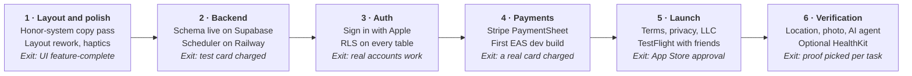

# LazyStakes — Product & Technical Spec

_Last updated: October 15, 2026_

---

## Overview

LazyStakes charges you real money when you skip something you committed to. You pick the task, the days, and the amount, and if the day isn't marked done by 11:59 pm your card is charged automatically.

The target user is someone who already knows what they should be doing and doesn't do it. Not a beginner who needs a plan — someone who has a gym membership and skips, keeps forgetting the grocery run, or has owed someone an email for two weeks. The product adds nothing but consequence.

Commitments are any recurring task, not just workouts. Version 1 verifies everything on the honor system: the user marks the day done themselves. Stronger proof (location, photos, an AI agent that picks the right proof for each task) is the final phase, after the app is otherwise complete.

**Premise:** a commitment with no cost isn't a commitment.

### Current status

Front end is built against mock data, no backend wired. Five of six planned UI phases are complete: theme system, today screen, commitment creation with consent capture, commitments list and detail, and the perimeter screens (sign-in, onboarding, settings, payment). The project is on Expo SDK 57.

The current screens were built for the earlier gym-and-HealthKit direction. They need a pass to match the honor-system v1 — "Log workout" becomes "Mark done", HealthKit and QR copy comes out, the stake cap drops to $20 — alongside a layout rework that is still being designed.

| Area | State |
| --- | --- |
| Design system (Block theme, light + dark) | Built |
| Today screen, all six states | Built, copy needs honor-system pass |
| Create and confirm flow | Built, copy and stake cap need honor-system pass |
| Commitments list and detail with history | Built |
| Sign-in, onboarding, settings, payment | Built, onboarding and settings need honor-system pass |
| Layout rework | Being designed |
| Polish pass (transitions, haptics, loading, errors) | Not started |
| Postgres schema | Not in repo — to be written |
| Scheduler and Stripe service | Not in repo — to be written |
| Auth | Not started |
| Verification beyond honor system | Final phase — not started |

### Stack

React Native with Expo SDK 57 and TypeScript on the client, built from Windows via EAS Build. Supabase for Postgres and Sign in with Apple. A small TypeScript service on Railway for the scheduler and Stripe. Development happens entirely on Windows; no Mac is required at any point including App Store submission.

Because v1 uses no native-only modules, the app runs in Expo Go until the payments phase. Note that Expo Go on iOS only supports the latest SDK, so the project has to keep up with SDK releases while it's being developed that way.

---

## Core model

Four objects carry the whole product. Getting these right matters more than any screen, because every feature is a view onto them.

**Commitment** — the standing agreement. A title, a set of weekdays, a stake amount, a deadline time, and a free-pass allowance. It persists until paused or deleted.

**Check-in** — one commitment on one calendar day. Created in advance by the scheduler, not computed at midnight. Carries its own snapshot of the stake, so raising your stake never rewrites what past days cost you.

**Evidence** — a reason a check-in was verified. In v1 the only kind is a self-report: the user tapped "Mark done". Kept as its own table, separate from the check-in, so the location, photo, and other proof types in the final phase slot in without a migration, and one day can accumulate several signals.

**Charge** — a Stripe payment tied to exactly one missed check-in. One-to-one, enforced by a unique constraint.

### State machine

A check-in is created `pending` and resolves exactly once at its deadline:

| Terminal state | Condition | Money |
| --- | --- | --- |
| `verified` | Qualifying evidence received before the deadline (v1: the user marked it done) | None |
| `excused` | No evidence, free pass available | None |
| `missed` | No evidence, no pass left | Charged |

There is no path back out of a terminal state. A day that resolved stays resolved — manual reversal happens as a refund on the charge, never as a status edit, so history always matches the bank statement.

### Rules that are deliberate, not incidental

1. **The server owns all time.** Deadlines are computed from the commitment's stored timezone, not the device's. Changing your phone clock or flying to Tokyo doesn't move a deadline.
2. **Only `server_received_at` counts.** A "Mark done" tap made offline at 11:50 pm and synced at 12:05 am is late. Enforcement uses when the server got the evidence, which makes backdating useless — and applies unchanged to every future proof type.
3. **Honor-system stakes are capped at $20.** A safety rail, not a technical limit. The failure mode is someone setting $200, getting sick, and spiralling. The cap is lower than it would be for verified proof because an honor-system stake is really a test of whether you'll own up; above $20 the temptation to tap "done" anyway outweighs the motivation. When stronger proof arrives in the final phase, commitments using it can go up to $50.
4. **One free pass per month, applied automatically.** The user doesn't have to ask or appeal. It absorbs illness, travel, and genuine emergencies without a support ticket.
5. **Ratios, not streaks.** Progress is shown as kept-of-scheduled. Breaking a 40-day streak and paying $5 in the same moment is the canonical churn event.
6. **A new commitment can never charge same-day.** First possible charge is tomorrow at the earliest.

---

## Feature spec

### Sign in

Sign in with Apple only. No email/password, no social logins — one tap, no password reset flow to build, and Apple's private relay means you never hold a real email address unless the user shares one.

The screen states the premise before login: the stake amount is visible, and the copy says you pay when you miss. Anyone who bounces here was never going to keep a commitment; burying the model converts them into refund requests instead.

### Onboarding

Three screens, each preventing a specific support ticket.

| Screen | Covers | Prevents |
| --- | --- | --- |
| You set the stakes | Task, days, amount, $1–$20 range, 11:59 pm deadline | "Why was I charged?" |
| You mark it done | Tap "Mark done" before the deadline, it has to reach the server in time, 6 pm and 10 pm reminders | "I did it and it still charged me" |
| There are limits | Free pass, $20 cap, pause any time | "I want a refund, I was sick" |

Skippable on screens 1 and 2, not on 3.

### Today

The screen people open at 6 am and 10 pm. Answers one question: is anything due, and have I done it?

Six states, sharing a fixed layout so the card never reflows when a day verifies mid-afternoon:

- `pending` — stake in violet, time remaining, Mark done button (with a confirm, so a stray tap doesn't count)
- `verified` — stake in green, labelled "Kept", with the time it was marked done
- `missed` — stake in red, "Charged", with the time and card
- `excused` — stake in violet-tint, "Free pass", with passes remaining
- rest day — nothing due, next due date, deliberately not celebratory
- empty — no commitments at all, with a create prompt

Below the hero: upcoming days as dense rows, then a new-commitment button. Header carries a commitments-list icon, a settings icon, and the light/dark toggle.

### Create commitment

One scrollable screen, not a wizard. Every choice interacts with every other one — three days at $10 is a different commitment from five days at $5 — so they stay visible together.

Fields: title (free text — any task, not just workouts), days (7-chip picker), stake (stepper in $1 increments with $5/$10/$20 presets, clamped $1–$20). No venue or verification-method fields in v1; they return in the final phase.

Above the button sits an **exposure block** stating the worst case in plain money: most you could pay in a week, and in a month after one free pass. Most apps in this category bury that arithmetic. Showing it is both honest and the thing that stops someone setting a number they'll resent in three weeks.

### Confirm and consent

Restates the deal and captures the consent record. The screen exists as much for chargeback defence as for UX — this exact language plus a timestamp is what gets sent to Stripe in a dispute. It names the amount, the trigger, the schedule, and the card.

The checkbox is unticked by default. A pre-checked consent box is both a dark pattern and worthless as evidence.

### Commitments list

All commitments, active first, paused sorted below rather than hidden behind a filter — someone who paused three weeks ago has effectively abandoned it, and visibility is a gentle prompt to resume or delete. Each card shows schedule, stake, a kept-ratio bar, and total paid.

### Commitment detail

Ordered identity → performance → history → dangerous actions. Stake block and day strip at top, three stat tiles (kept / missed / paid), configuration rows, then history grouped by month with each day's evidence source and amount. Pause and delete sit at the very bottom; delete goes through a native confirm.

Pausing takes effect on the next scheduled day, never today — otherwise it's an escape hatch from a day already in progress.

### Settings

Appearance (system/light/dark, persisted), payment, reminders, account, legal, sign out. Permission settings for location, camera, and Health arrive with the final phase.

The reminder toggles carry a warning rather than being silently disableable. Turning off the final warning is legitimate, but "I was never told" is the most common opening line of a chargeback, so the consequence is stated at the point of decision.

### Payment

Card on file, total paid all-time, and a full charge history with dates and source commitments. The history is not optional: people dispute charges they can't find a record of, and an in-app list matching their bank statement resolves most complaints before Stripe hears about them. The billing descriptor is shown for the same reason.

No card form. Stripe's PaymentSheet collects card details inside Stripe's own UI, which keeps raw card numbers off your servers entirely.

---

## Verification (v1: honor system)

Version 1 has exactly one proof type: the user taps **Mark done**, confirms, and the app posts a self-report to the server. If it arrives before the deadline, the day is `verified`. Nothing else is checked.

This is a deliberate scoping decision, not a placeholder. It lets the whole money loop — scheduling, reminders, deadlines, charges, disputes — ship and be proven with real users before any verification work starts. Every task type works on day one, from "go to the gym" to "email Sam back", and the app needs no location, camera, or Health permissions.

The confirm step matters more than it looks. "Mark done" is the one action that decides whether someone pays, so a stray tap in a pocket shouldn't count. The dialog is plain — "Mark today's _Go to the gym_ as done?" — not a guilt prompt.

The stronger proof types — location, photo, multiple proofs per commitment, and an AI agent that chooses between them — are specified in [Final phase — verification](#final-phase--verification) and built last.

### The trust model

This is the part that holds the product together, and it's worth being explicit about.

Verification is adversarial in form but not in substance. The user is both the one being checked and the one paying — gaming the system means paying nothing and getting nothing, which is self-defeating. The system therefore optimises for _friction against laziness_, not for fraud prevention. That's what makes an honor-system v1 viable at all: the small deliberate act of marking something done, knowing you'd be lying to yourself for $10, is most of the effect. The $20 cap keeps the temptation to lie smaller than the motivation to go.

What it does defend against rigorously is the accidental and the ambiguous:

- **Clock manipulation** — the server computes deadlines from the commitment's stored timezone. Device time is never consulted.
- **Backdating** — enforcement uses `server_received_at`, never a timestamp the device supplies.
- **App deletion** — all state and all decisions live server-side. Uninstalling changes nothing.
- **Double-counting** — one self-report per check-in; repeated taps are idempotent.
- **Race conditions** — resolution runs inside a transaction with `SELECT … FOR UPDATE SKIP LOCKED`, so two workers can't resolve the same check-in.

---

## Money

### Revenue model

The money is revenue. Missed-day charges go to the app's own account and stay there.

This is the single most important architectural decision in the product, and it's a legal one rather than a technical one. If a user's $5 went to a friend, a charity, or a pooled prize, you would be moving funds on someone else's behalf — that is money transmission, and it means state-by-state licensing that costs more than the business would make. Keeping the money makes you an ordinary merchant. Beeminder operates on exactly this model.

**Do not add social pots, charity donations, or friend-to-friend stakes without talking to a lawyer first.** They are the most requested feature in this category and the one that would convert a side project into a regulated money services business.

### Charge lifecycle

1. Deadline passes with no qualifying evidence and no free pass available
2. Check-in marked `missed` and a `charges` row inserted — same transaction, so a crash can never produce a miss with no charge or a charge with no miss
3. A separate worker picks up pending charges and calls Stripe
4. PaymentIntent created with `off_session: true` and `confirm: true` against the saved payment method
5. Result written back; failures retry up to three attempts

### Idempotency

Every charge carries an idempotency key derived from its check-in id: `checkin_<uuid>`.

If the server times out mid-call and retries, Stripe returns the original PaymentIntent rather than creating a second one. Double-charging someone for one missed gym day would be fatal to trust in a product whose entire premise is that the charging is fair. This one line is the insurance.

### Chargeback defence

Charging people for failing is the most disputable transaction type that exists. Five mechanisms, all already in the schema:

| Mechanism | Table | What it proves |
| --- | --- | --- |
| Consent record | `consent_records` | Exact language agreed to, with timestamp and IP |
| Notification log | `notifications_log` | They were warned at 6 pm and 10 pm |
| Free passes | `free_pass_usage` | Genuine emergencies were absorbed, not charged |
| In-app history | `charges` | They could see every charge and its cause |
| Clear descriptor | GYMSTAKES on statement | Not an unrecognised line item |

The payment screen asks people to contact support before disputing. A refund costs you $5; a chargeback costs you $5 plus a $15 fee plus a mark against your dispute rate. Refund generously and early.

### What is never built

No card form in the app. Stripe's PaymentSheet collects details inside Stripe's own UI, so raw card numbers never touch your code or your server and you stay entirely outside PCI compliance scope. Building a card form would be a large, expensive, and completely unnecessary mistake.

ACH is also out for v1 — cheaper per transaction, but slow to settle and carries return risk on $5 charges that makes the economics worse, not better.

---

## Data model

Postgres 15+ on Supabase. Nine tables in v1; the final phase adds `places` and `commitment_proofs` (see [Final phase — verification](#final-phase--verification)).

| Table | Holds | Notable constraint |
| --- | --- | --- |
| `users` | Apple subject id, timezone, Stripe customer id | — |
| `payment_methods` | Stripe payment method references and display metadata | One default per user |
| `commitments` | Title, weekdays, stake, timezone, deadline time, passes | Stake $1–$20 (honor system) |
| `check_ins` | One row per commitment per due date | Unique on (commitment, date) |
| `evidence` | Proof a check-in was done. `kind` is an enum; v1 uses only `self_report` | One `self_report` per check-in |
| `charges` | One Stripe charge per missed check-in | Unique on check-in |
| `free_pass_usage` | Passes consumed per commitment per month | Unique on check-in |
| `consent_records` | Exact agreed language with timestamp and IP | — |
| `notifications_log` | Reminders and warnings actually sent | — |

The stake check constraint should be written so it can be relaxed per proof type later (e.g. a `max_stake_cents` derived from the commitment's proof methods) rather than hard-coding $20 into the column.

### Decisions worth preserving

**Money is stored in cents, as integers.** Floats produce rounding bugs that surface as a user being charged $4.99 instead of $5.00. Formatting happens only at the display edge.

**`check_ins.stake_cents` is a snapshot, not a reference.** If history read the stake off the commitment, raising your stake from $3 to $5 would retroactively rewrite what every past miss cost you. The mock data deliberately includes a stake bump so this shows up in the UI.

**`check_ins.deadline_utc` is precomputed.** The deadline job then runs one indexed query instead of scanning every commitment and doing timezone arithmetic per row.

**`commitments.timezone` is snapshotted at creation.** Travel doesn't move your deadlines. This is a product decision as much as a technical one — a deadline that drifts with your location is one you can game by flying west.

**`charges.idempotency_key` is unique and derived.** Always `checkin_<check_in_id>`, never random, so a retry after a timeout cannot produce a second charge.

**`charges.check_in_id` uses `ON DELETE RESTRICT`.** Financial records don't cascade away when a commitment is deleted.

**The partial index `check_ins (deadline_utc) WHERE status = 'pending'`** is the single most important index in the system — it's the deadline job's query, running every fifteen minutes forever.

### Row-level security

Supabase's anon key ships inside the app bundle and is extractable by anyone. That's fine and by design, _but only if RLS is enabled on every table_. With RLS off, the anon key is full read access to your database.

RLS must be on before any real user data exists. Every table gets a policy scoped to `auth.uid()`; `charges`, `consent_records`, and `notifications_log` are read-only to the client and written only by the service role.

---

## Architecture

The app is almost a thin client. It renders state and forwards evidence; every decision about whether a day counts and whether a card gets charged happens on the Railway service. The final phase adds photo storage and an AI service on the right-hand side of this diagram; the app's role doesn't change. That split is deliberate — it means deleting the app doesn't escape a charge, and enforcement bugs can be fixed without shipping an App Store update.

### A day, end to end

1. **2 am UTC** — the scheduler materialises check-ins two days ahead for every active commitment, skipping any whose deadline has already passed
2. **Morning** — the user opens the app; it reads today's pending check-in from the API
3. **Evening** — they go to the gym, then tap Mark done and confirm; the app POSTs a self-report and the service writes an `evidence` row stamped with `server_received_at`
4. **6 pm and 10 pm** — reminder and final warning push, but only if the day is still unverified; every send is logged
5. **11:59 pm local** — `resolveDeadlines()` finds the check-in, sees evidence received before the deadline, marks it `verified`
6. **Had there been none** — it marks `missed` and inserts a charge row in the same transaction; `processCharges()` picks it up within fifteen minutes

### The three jobs

All three run on a cron and all three are idempotent — rerunning after a crash produces the same result, which matters more than speed in a system that moves money.

| Job | Cadence | Does |
| --- | --- | --- |
| `materializeCheckIns` | Nightly | Creates pending check-ins from active schedules |
| `resolveDeadlines` | Every 15 min | Verifies, excuses, or marks missed and queues the charge |
| `processCharges` | Every 15 min | Calls Stripe with the derived idempotency key |

### Build pipeline

Code is written in VS Code on Windows. EAS Build compiles on Apple hardware in the cloud and returns an installable app, which goes onto a physical iPhone. JavaScript changes hot-reload in seconds; a cloud build is needed only when native modules change. App Store submission runs through `eas submit`, also from Windows.

---

## Design system

The theme is called **Block**. Its signature is a saturated filled rectangle holding the money, which changes colour with state. Everything else stays quiet so that block is the loudest thing on screen.

### Colour

Cool-biased neutrals, so the violet reads as a deliberate accent rather than a tint of the background. Each stake state is a background / foreground / label triple — text on a saturated fill needs its own tone, never plain white or plain grey.

| Role | Light | Dark |
| --- | --- | --- |
| Background | `#F2F0F5` | `#111014` |
| Surface | `#FFFFFF` | `#1B1A20` |
| Text primary | `#16151A` | `#F4F3F7` |
| Text secondary | `#6E6B78` | `#A29EAD` |
| Accent | `#5B3DF5` | `#7C5CFF` |
| Stake · pending | `#5B3DF5` on white | `#6B4AFF` on white |
| Stake · kept | `#E4F6EF` / `#0B7A50` | `#14312A` / `#4FCB99` |
| Stake · charged | `#FCEAE9` / `#A32D2D` | `#331C1C` / `#E88B84` |

Dark mode is a designed palette, not an inversion. The kept and charged fills in particular needed their own dark values — pale mint on black is unreadable.

### Typography

One family, three weights: Space Grotesk at 400, 500, and 700. The bold weight at 34px does the work a monospace was doing in an earlier direction, which removed two font packages from startup.

Money always carries `fontVariant: ['tabular-nums']` so digits don't shift width as values change.

### Spacing and shape

8px base scale (4, 8, 12, 16, 20, 28, 44). Radius 16 on cards, 12 on blocks and controls. Generous radius is the main shape signal of this direction.

### Component vocabulary

`StakeBlock` is the signature primitive and owns the state-to-colour mapping in one place — five states, each a colour triple. Every screen showing money uses it. Together with `tokens.ts` it is the entire surface area for retuning the theme.

Supporting: `Card`, `Sunken`, `Hairline`, `StatusDot`, `Button`, `Segmented`, `Screen`, pre-toned text primitives, `DayPicker` / `DayStrip`, `StakeStepper`, `StatTile`.

### Behavioural rules

These matter more than the colours and should survive any visual redesign.

1. **Pending money is never red.** Red appears only after a charge has landed. Colouring an at-risk stake red manufactures low-grade dread on every scheduled day, which is what makes people delete these apps in week three.
2. **Time remaining is coarse and static.** "6 hr 31 min left", recalculated on mount. A ticking countdown would be trivial to add and would make the app feel like a bomb defusal.
3. **Success is quiet.** A state change and a colour, no confetti. The reward for going is not being charged.
4. **Copy at the moment of failure is factual and past tense.** "Charged 11:59 pm", never "You missed it!" The money is the consequence; adding disappointment turns one bad day into an uninstall.
5. **Success is framed as retention, not cancellation.** The verified state says "Kept" and still shows $5. You didn't avoid a charge, you kept your money.
6. **Destructive actions sit last.** Delete is below pause, styled as a ghost button, behind a native confirm.

### Single source of truth

`src/theme/tokens.ts` is the only file in the app containing a hex value or a font name. If a component needs a colour that isn't there, it gets added there first. That constraint is what keeps the design coherent past a dozen screens.

---

## Build phases

The ordering rule: each phase ends in something that runs on a physical phone. No phase is "write a bunch of infrastructure and hope."

Verification is deliberately last. The honor system is a complete product on its own, and every later proof type is an addition to the `evidence` table, not a change to the money loop. Shipping the loop first means it gets proven with real charges before anything harder is layered on.

### Phase 1 — Layout and polish

First, bring the existing screens in line with the honor-system v1: "Log workout" becomes "Mark done" with a confirm; HealthKit, QR, Apple Watch, and venue copy comes out of Today, create, confirm, onboarding, settings, and detail; the stake stepper clamps at $20; mock evidence becomes `self_report`. Then the layout rework, which is still being designed.

Then polish: transitions, haptics on stake changes and on marking a day done, loading skeletons, error states, and an empty state for every list. Finish the dark mode audit across all screens.

Worth doing before the backend because it's the last time the UI can change cheaply. Once screens are wired to real data, every layout change touches two codebases.

### Phase 2 — Backend and scheduler

Supabase project, write and run `schema.sql` (it isn't in the repo yet), insert a user and commitment by hand, then confirm `materializeCheckIns()` creates the right rows for the right days. Timezone bugs surface here, which is exactly where you want them.

Then the Railway service with `node-cron`: materialise at 2 am UTC, resolve and charge every fifteen minutes. Test the whole loop in Stripe test mode with a deadline five minutes out.

**Do not move on until you've watched a test card get charged for a missed check-in and confirmed that rerunning the job doesn't charge it twice.** That's the single most important verification in the build.

### Phase 3 — Auth and real data

Sign in with Apple, RLS policies on every table, and swap the mock imports for real API calls. The screens shouldn't need restructuring — they already take typed props that match the schema.

### Phase 4 — Real payments

Stripe PaymentSheet for card capture, SetupIntent stored against the customer, webhook handling for async failures and disputes, and charge receipts. Switch from test keys to live keys last.

First EAS development build happens here: Stripe's React Native SDK and the real Sign in with Apple button both need native code that Expo Go doesn't carry.

Before the first live charge: LLC formed, terms of service written, consent records actually being captured.

### Phase 5 — Launch

Privacy policy, reviewer note explaining the payment model, account deletion flow, App Store listing and screenshots.

TestFlight with ten people who have something they keep skipping, for at least two weeks. You need to see a real charge land on someone who isn't you — that's the only way to find out whether the warnings fire correctly and whether the copy reads as fair at the moment it costs money.

### Phase 6 — Verification

Built after the app is otherwise finished and launched. Fully specified in the next section.

---

## Final phase — verification

Everything in this section is built last, after launch. None of it changes the check-in state machine, the charge pipeline, or the deadline rules — each proof type is just a new `evidence.kind` that `resolveDeadlines()` accepts.

### Proof types

| Kind | How it works | Good for | Permission |
| --- | --- | --- | --- |
| `self_report` | Tap Mark done and confirm (the v1 method) | Emails, calls, anything unprovable | None |
| `location` | Tap Complete; one foreground location reading; server checks it's inside a saved place | Pick up a prescription, show up to class | Location, while in use |
| `location_dwell` | As above, plus a second reading 15 minutes later that must also be inside the place | Gym, study session, office hours | Location, while in use |
| `photo` | Photo taken with the in-app camera, checked by the AI agent | Groceries, meal prep, a clean room | Camera |
| `healthkit_workout` | Logged workout of 15+ minutes verifies automatically | Workouts, for users who want zero taps | HealthKit |

The earlier spec's QR check-in is dropped: location covers the same ground with real proof, and the honor system covers people who won't grant location.

### More than one proof per commitment

A commitment can accept several proof types, and **any one** of them verifies the day — groceries can be proven by a photo of the shopping _or_ a location check-in at the store. Stored as a `commitment_proofs` table (commitment, kind, config such as place id or dwell minutes), not columns on `commitments`, so adding a kind never needs a migration.

### Stake caps follow the weakest proof

The cap is set by the weakest accepted proof, because that's the one someone will use on a bad day:

- Any commitment that accepts `self_report` — **$20**
- Every accepted proof is location, location-dwell, photo, or HealthKit — **$50**

The create screen shows the cap change live as proof types are toggled, so adding honor as a fallback visibly lowers the ceiling.

### Location

- **Places.** A `places` table holds the user's saved places — label (Home, Office, Gym, School, Grocery store), coordinates, radius. Added via "Use my current location" or address search. Replaces the earlier `venues` table.
- **Foreground only.** One reading with `expo-location` at the moment the user taps Complete. This needs only while-in-use permission, which most people grant — the reason the earlier spec deferred geofencing (`always` permission, high refusal, periodic iOS re-prompts) doesn't apply.
- **The server decides.** The app sends the raw reading (lat, lng, accuracy); the server accepts it if the distance to the place is within `radius + accuracy`, and rejects readings with accuracy worse than ~100 m outright. `server_received_at` still governs the deadline.
- **Spoofing is accepted.** A user who installs a GPS spoofer to avoid a $10 charge has paid in effort what they saved in money. Consistent with the trust model.

### Location with a 15-minute stay

For tasks that take time — a workout, not a pickup — arriving isn't enough. The first reading starts a stay; 15 minutes later a second reading must also land inside the place.

How the second reading is taken: the app schedules a local notification for +15 minutes ("Still at the gym? Tap to confirm"); tapping it opens the app and takes another foreground reading. This avoids background location entirely. Users who have granted `always` permission can have the second reading taken silently instead.

Rules: the day stays `pending` until the second reading passes; both readings must reach the server before the deadline (so starting at 11:50 pm can't work, and the app says so before the user starts); a failed second reading can be retried while still on site.

Which tasks need a stay, and how long, is something the AI agent proposes (below) and the user can edit.

### Photo

- **Camera only.** Taken with `expo-camera` inside the app; no photo-library picker, so yesterday's photo can't be reused.
- **Private storage.** Uploaded to a private Supabase Storage bucket, readable only by the owner and the service role. Timestamped by the server on receipt.
- **Checked by AI.** The agent compares the photo with what the commitment expects ("groceries — bags, a stocked fridge, or a receipt") and records a verdict on the evidence row. A rejected photo can be retaken before the deadline. An ambiguous result is accepted — the trust model favours the user over the classifier.
- **Deleted after 30 days.** A nightly `purgePhotos` job (a fourth cron job, idempotent like the others) deletes photo files older than 30 days. The evidence row stays — kind, received time, AI verdict — so history still shows the day as proven after the image is gone. Account deletion removes all photos immediately.

Note the tension with chargebacks: card dispute windows run up to 120 days, longer than photos are kept. That's acceptable because photo evidence only ever _prevents_ charges — a disputed charge is always on a day with no accepted proof, so the photo would never be part of the evidence package.

### The verification agent

The piece that makes many task types workable without a settings screen per type. An AI agent on the Railway service (calling a Claude vision-capable model with the API key held server-side, never in the app) does two jobs:

1. **At creation — propose proof.** Reads the commitment title and an optional one-line description and proposes proof types with their config: "Go to the gym" → location-dwell at a saved place; "Buy groceries" → photo of groceries, or location at a grocery store; "Email Sam" → honor system. The user sees the proposal on the create screen and can change it. The agent proposes; it never silently decides.
2. **At verification — check photos.** Judges whether a photo plausibly shows the expected thing. Verdicts and the model version are stored on the evidence row for auditability.

If the agent is down, creation falls back to manual proof selection and photo checks queue and retry; a photo received before the deadline counts by its `server_received_at` even if the check finishes after.

### HealthKit (optional)

A logged workout of 15 minutes or more verifies the day automatically via `HKObserverQuery` with background delivery. Requires a development build and a physical iPhone (the Simulator has no workout data). Each workout's HealthKit UUID has a unique constraint so one session can't satisfy two days. Timebox it: if background delivery is unreliable after a week, fall back to foreground sync on app open.

### Compliance for this phase

- Permission strings: `NSLocationWhenInUseUsageDescription`, `NSCameraUsageDescription`, and the HealthKit justification — each stating exactly what is read and why. Vague strings get rejected.
- The privacy policy must be updated before release to cover location readings, photos, sending photos to an AI provider for checking, and the 30-day deletion.
- Every proof type stays optional: the app must keep working for users who grant no permissions, which the honor system guarantees.

---

## Compliance and App Store

### Apple review

This app will get more scrutiny than a typical submission. Three things to prepare.

**In-app purchase.** A penalty charge is not digital content being unlocked, so it goes through Stripe directly rather than IAP, under guideline 3.1.3(e). Beeminder and StickK both operate this way, so precedent exists. But reviewers frequently assume on first pass that you're dodging IAP, so include a reviewer note explaining the model. If premium app features are added later, _those_ must go through IAP.

**Permissions.** v1 requests no location, camera, or Health access, which keeps the first review simple. The final phase adds all three; see [Compliance for this phase](#compliance-for-this-phase). HealthKit data may never be used for advertising, and the app must function for users who decline every permission — the honor system guarantees that.

**Account deletion.** Apple requires in-app account deletion for any app with account creation. Must be reachable from settings, not email-only.

### Business and legal

| Item | When | Notes |
| --- | --- | --- |
| Apple Developer Program | Before any build | $99/yr; enrollment can take 48 hours |
| LLC | Before taking real money | Don't collect consumer payments personally |
| Stripe account | Phase 2 | Test mode is fine until launch |
| Terms of service | Before real charges | The single most important document |
| Privacy policy | Before submission | Required by Apple; must be revised before the verification phase ships |

The terms of service must explicitly authorise the charge — naming the amount, the trigger, and the automatic nature. That document plus `consent_records` and `notifications_log` is your dispute evidence package. Worth paying a lawyer for a review; a template alone is thin for a product whose whole function is debiting people.

### The money transmitter line

Restating because it determines what features can ever exist: money that stays with the business is merchant revenue. Money that moves to another party — a friend, a charity, a pooled pot — is money transmission and triggers state-by-state MSB licensing.

Social stakes are the most-requested feature in this category and the one that would convert a side project into a regulated financial business. Treat any version of it as requiring legal advice first, not as a sprint item.

---

## Risks and open decisions

### Risks

**The honor system is the whole verification in v1.** That weakens the product promise — some users will tap "done" without doing it. Accepted deliberately: the $20 cap keeps the payoff from lying small, cheating is self-defeating, and it lets the money loop ship and be proven before any verification work. The final phase strengthens it without migration.

**The verification agent can be wrong.** A false rejection of a real grocery photo is the worst outcome — the user did the thing and gets charged. Mitigation: retakes before the deadline, ambiguous results accepted, every verdict stored, and refunds issued generously when it misfires.

**HealthKit background delivery** remains the biggest technical unknown, but it's now an optional extra in the final phase rather than the primary path, so it can fail without blocking anything.

**Chargeback rate is an existential risk, not an annoyance.** Processors terminate accounts over sustained high dispute rates. Every defence in the schema exists for this. Refund generously and early — a refund costs $5, a chargeback costs $5 plus fees plus your standing.

**Apple rejection on the IAP question** is plausible on first submission. Mitigation is the reviewer note and the Beeminder precedent. Budget for one rejection cycle.

### Decided

- [x] v1 verification is honor system only; all other proof types are the final phase
- [x] Honor-system stakes cap lower than verified ones ($20 vs $50)
- [x] A commitment can accept more than one proof type; any one verifies the day
- [x] Time-based tasks use a second location reading 15 minutes after the first
- [x] Photos are deleted after 30 days

### Open decisions

- [ ] Exact honor-system cap — $20 is a proposal that matches the existing top preset
- [ ] Does a failed charge (expired card, insufficient funds) retry, pause the commitment, or lock the app until resolved?
- [ ] Is the 15-minute stay fixed, or proposed per task by the agent (e.g. 45 minutes for a workout)?
- [ ] Can a user override the agent's proof proposal down to honor system for a task the agent thinks is provable?
- [ ] What happens when someone travels across timezones mid-commitment — current design freezes the original timezone, which is defensible but will generate confused support messages
- [ ] Is there a free tier, or does every user need a card on file to use the app at all?
- [ ] Should stake increases apply immediately or only from the next week, to prevent raising stakes impulsively mid-week
- [ ] Account deletion: what happens to pending charges at deletion time?
